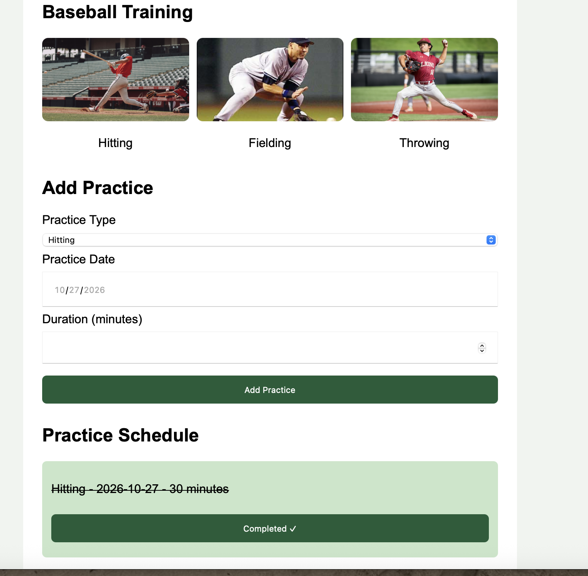
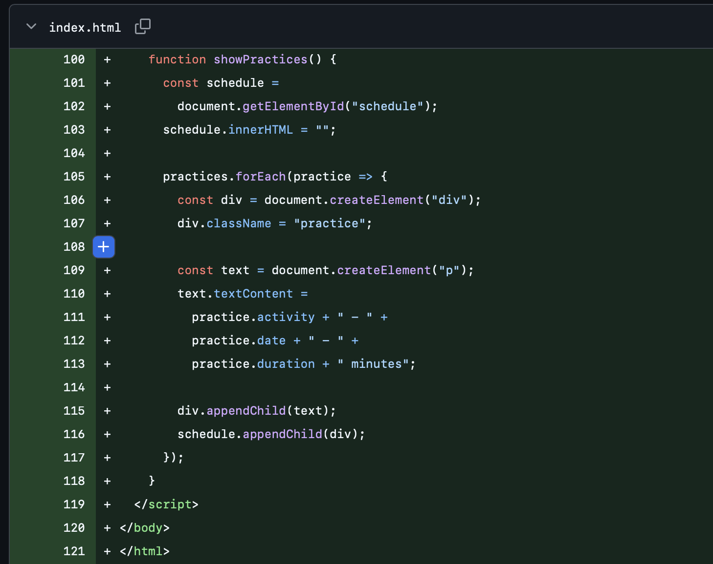

# AI 101 Midterm — Project Evidence

**Name:** Max Hansen

**Project:** Baseball Practice Planner

**Live Website:** https://maxhansen7.github.io/baseball-practice-planner/

## Audience and Purpose

My website is designed for college baseball players who want to organize extra practice outside of team activities. It helps players schedule hitting, fielding, and throwing workouts and track their progress.

## Two Working Features

**Feature 1: Add Practice**

Players can select a practice type, choose a date, enter the duration, and add the activity to their schedule.

**Feature 2: Mark Complete**

Players can click Mark Complete after finishing a practice. The activity changes color, the text gets crossed out, and the button displays Completed.

## AI Prompts

**Initial prompt:** I asked ChatGPT to help plan a simple baseball practice website for college baseball players.

**Follow-up prompt:** "can you add more to my baseball practice planner mid term"

The exact prompt records and additional details are in AI_USE.md.

## Before and After Revision

**Before:** My website allowed players to add practices, but it did not have the Mark Complete feature.

**After:** I added a Mark Complete button so players can track finished activities.

**Before: Original Website Code**

**After: Updated Website**

This screenshot shows my updated website with baseball pictures and a completed practice.

**After screenshot:** To be added showing the completed practice.

## Problem Solved

During development, I worked on making the Mark Complete feature function correctly. I tested it and confirmed that clicking the button changes the appearance of a completed practice.

During final testing, I also had trouble navigating the form with Tab. After troubleshooting my Mac keyboard settings, I successfully completed the keyboard test.

## Testing Evidence

I tested the published GitHub Pages website using normal input, invalid input, repeated use, keyboard navigation, and an iPhone-sized screen.

All five tests passed during my final checks. The complete results are documented in TEST_LOG.md.

## Known Limitation

Practices are not saved permanently after refreshing the webpage. Future improvements could include saved schedules, practice videos, and reminders.
